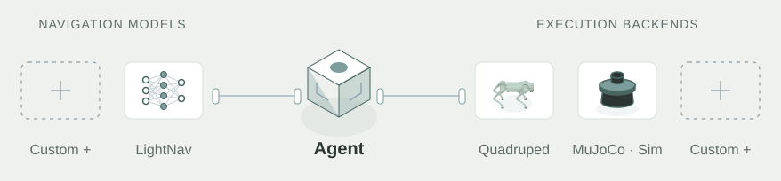

<p align="center"><a href="README.md">English</a> · <strong>简体中文</strong></p>

<h1 align="center">Navigation Agent</h1>
<p align="center"><em>描述目标，让机器人自主寻找。</em></p>
<p align="center">
  
  <a href="LICENSE"></a>
</p>

## 概览

Navigation Agent 根据自然语言目标，自主观察、探索并导航到目标。
先用配好的 MuJoCo 场景上手，再按需接入机器人。

<p align="center">
  <a href="https://novaxis-robot-group.github.io/navigation-agent-site/#architecture">
    
  </a>
</p>
<p align="center"><sub>同一套 Agent，独立适配导航模型与本体。虚线表示待实现和验证的扩展点。</sub><br>
  <a href="https://novaxis-robot-group.github.io/navigation-agent-site/">项目官网 →</a>
</p>

## 快速开始

**需要：** Linux、兼容 LightNav 的 NVIDIA GPU、Conda、Docker（含 NVIDIA Container Toolkit）、Git 和 GNU Make。[环境要求](docs/zh/mujoco.md#环境要求)。

下载仓库后，在仓库根目录执行。首次准备会下载数 GB 级依赖和模型，并构建容器镜像。

**1. 首次准备**

```bash
make mujoco-setup
```

自动准备运行环境、场景与模型。完成后，在 `deploy/.env` 填入 `DASHSCOPE_API_KEY`。

**2. 日常启动**

```bash
make mujoco
```

看到 **MuJoCo 已就绪** 后，打开 [localhost:8088](http://127.0.0.1:8088)，输入 **“找到棕色沙发”**。
以后只需这条命令。取消任务并等待空闲后，按 `Ctrl+C` 退出。

## 文档

[MuJoCo 使用指南](docs/zh/mujoco.md) · [Go2 真机部署](docs/zh/go2.md) · [自定义接入](docs/zh/integration.md)

[模型部署](docs/zh/deployment.md) · [运行配置](docs/zh/configuration.md) · [回放与录像](docs/zh/replay.md)

---

[Apache-2.0](LICENSE) · © 2026 Novaxis（智疆启元）· [第三方声明](THIRD_PARTY_NOTICES.md)

GitHub 仓库用于源码发布，暂不接收外部 PR。
